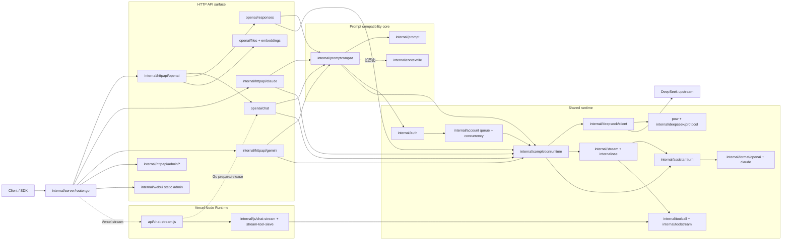

# DS2API 架构与项目结构说明

语言 / Language: [中文](ARCHITECTURE.md) | [English](ARCHITECTURE.en.md)

> 本文档用于集中维护“代码目录结构 + 模块边界 + 主链路调用关系”。

## 1. 顶层目录结构（核心目录）

> 说明：以下为仓库内主要业务目录（排除 `.git/` 与 `webui/node_modules/` 这类依赖/元数据目录），并标注每个文件夹作用。新增目录以代码为准，不要求在本文做逐文件展开。

```text
ds2api/
├── .github/                              # GitHub 协作与 CI 配置
│   ├── ISSUE_TEMPLATE/                   # Issue 模板
│   └── workflows/                        # GitHub Actions 工作流
├── api/                                  # Serverless 入口（Vercel Go/Node）
├── app/                                  # 应用级 handler 装配层
├── artifacts/                            # 调试产物（raw-stream-sim, stream-debug 等）
├── cmd/                                  # 可执行程序入口
│   ├── ds2api/                           # 主服务启动入口
│   └── ds2api-tests/                     # E2E 测试集 CLI 入口
├── docs/                                 # 项目文档目录
├── internal/                             # 核心业务实现（不对外暴露）
│   ├── account/                          # 账号池、并发槽位、等待队列
│   ├── auth/                             # 鉴权/JWT/凭证解析
│   ├── chathistory/                      # 服务器端对话记录存储与查询
│   ├── claudeconv/                       # Claude 消息格式转换工具
│   ├── compat/                           # 兼容性辅助与回归支持
│   ├── assistantturn/                    # 上游输出到统一 assistant turn / stream event 的语义层
│   ├── completionruntime/                # Go 主路径共享 DeepSeek completion 启动、收集、空输出/切号 retry
│   ├── config/                           # 配置加载、校验、热更新
│   ├── contextfile/                      # 各协议共享 HISTORY.txt / TOOLS.txt 上传与续写
│   ├── deepseek/                         # DeepSeek 上游 client/protocol/transport
│   │   ├── client/                       # 登录、会话、completion、上传/删除等上游调用
│   │   ├── protocol/                     # DeepSeek URL、常量、skip path/pattern
│   │   └── transport/                    # DeepSeek 传输层细节
│   ├── devcapture/                       # 开发抓包与调试采集
│   ├── format/                           # 响应格式化层
│   │   ├── claude/                       # Claude 输出格式化
│   │   └── openai/                       # OpenAI 输出格式化
│   ├── httpapi/                          # HTTP surface：OpenAI/Claude/Gemini/Admin
│   │   ├── admin/                        # Admin API 根装配与资源子包
│   │   ├── claude/                       # Claude HTTP 协议适配
│   │   ├── gemini/                       # Gemini HTTP 协议适配
│   │   ├── ollama/                       # Ollama 兼容模型/能力查询接口
│   │   ├── openai/                       # OpenAI HTTP surface
│   │   │   ├── chat/                     # Chat Completions 执行入口
│   │   │   ├── responses/                # Responses API 与 response store
│   │   │   ├── files/                    # Files API 与 inline file 预处理
│   │   │   ├── embeddings/               # Embeddings API
│   │   │   └── shared/                   # OpenAI HTTP 公共错误/模型/工具格式
│   │   └── requestbody/                  # HTTP 请求体读取与 UTF-8/JSON 校验辅助
│   ├── js/                               # Node Runtime 相关逻辑
│   │   ├── chat-stream/                  # Node 流式输出桥接
│   │   ├── helpers/                      # JS 辅助函数
│   │   │   └── stream-tool-sieve/        # Tool sieve JS 实现
│   │   └── shared/                       # Go/Node 共用语义片段
│   ├── prompt/                           # Prompt 组装
│   ├── promptcompat/                     # API 请求到 DeepSeek 网页纯文本上下文兼容层
│   ├── rawsample/                        # raw sample 读写与管理
│   ├── responsehistory/                  # DeepSeek 上游响应归档与会话快照
│   ├── server/                           # 路由与中间件装配
│   │   └── data/                         # 路由/运行时辅助数据
│   ├── sse/                              # SSE 解析工具
│   ├── stream/                           # 统一流式消费引擎
│   ├── testsuite/                        # 测试集执行框架
│   ├── textclean/                        # 文本清洗
│   ├── toolcall/                         # 工具调用解析与修复
│   ├── toolstream/                       # Go 流式 tool call 防泄漏与增量检测
│   ├── translatorcliproxy/               # Vercel/fallback/测试用协议互转桥
│   ├── util/                             # 通用工具函数
│   ├── version/                          # 版本查询/比较
│   └── webui/                            # WebUI 静态托管相关逻辑
├── plans/                                # 阶段计划与人工验收记录
├── pow/                                  # PoW 独立实现与基准
├── scripts/                              # 构建/发布/辅助脚本
├── static/                               # 构建产物（admin 等静态资源）
├── tests/                                # 测试资源与脚本
│   ├── compat/                           # 兼容性夹具与期望输出
│   │   ├── expected/                     # 预期结果样本
│   │   └── fixtures/                     # 测试输入夹具
│   │       ├── sse_chunks/               # SSE chunk 夹具
│   │       └── toolcalls/                # toolcall 夹具
│   ├── node/                             # Node 单元测试
│   ├── raw_stream_samples/               # 上游原始 SSE 样本
│   │   ├── continue-thinking-snapshot-replay-20260405/    # continue 样本
│   │   ├── longtext-deepseek-v4-flash-20260429/           # flash 长文本/文件上传样本
│   │   ├── longtext-deepseek-v4-pro-20260429/             # pro 长文本/文件上传样本
│   │   ├── markdown-format-example-20260405/              # Markdown 样本
│   │   └── markdown-format-example-20260405-spacefix/     # 空格修复样本
│   ├── scripts/                          # 测试脚本入口
│   └── tools/                            # 测试辅助工具
└── webui/                                # React 管理台源码
    ├── public/                           # 静态资源
    └── src/                              # 前端源码
        ├── app/                          # 路由/状态框架
        ├── components/                   # 共享组件
        ├── features/                     # 功能模块
        │   ├── account/                  # 账号管理页面
        │   ├── apiTester/                # API 测试页面
        │   ├── chatHistory/              # 服务器端对话记录页面
        │   ├── proxy/                    # 代理管理页面
        │   ├── settings/                 # 设置页面
        │   └── vercel/                   # Vercel 同步页面
        ├── layout/                       # 布局组件
        ├── locales/                      # 国际化文案
        └── utils/                        # 前端工具函数
```

## 2. 请求主链路



## 3. internal/ 子模块职责

- `internal/server`：路由树和中间件挂载（健康检查、协议入口、Admin/WebUI）。
- `internal/httpapi/openai/*`：OpenAI HTTP surface，按 chat、responses、files、embeddings、shared 拆分；chat/responses 共享 promptcompat、stream、toolcall 等核心语义。
- `internal/httpapi/{claude,gemini}`：协议输入输出适配，归一到同一套 prompt compatibility 语义；正常直连路径必须通过 `completionruntime` 共享 DeepSeek session/PoW/completion 调用，`translatorcliproxy` 仅保留给 Vercel prepare/release、后端缺失 fallback 和回归测试。
- `internal/httpapi/ollama`：Ollama 兼容的模型列表与能力查询入口。
- `internal/httpapi/requestbody`：跨协议复用的请求体读取、JSON 解码前置校验与 UTF-8 错误处理辅助。
- `internal/promptcompat`：OpenAI/Claude/Gemini 请求到 DeepSeek 网页纯文本上下文的兼容内核。
- `internal/assistantturn`：Go 输出侧统一语义层，把 DeepSeek SSE 收集结果和流式收尾状态归一成 assistant turn，集中处理 thinking、tool call、citation、usage、stop/error 语义。
- `internal/completionruntime`：Go surface 共享的 completion 执行辅助，负责 DeepSeek session/PoW/call 启动、非流式 collect、empty-output retry，以及托管账号在最终 429 前的一次切号 fresh retry；流式路径复用它启动上游请求，继续用 `internal/stream` 做实时消费，并在最终收尾阶段接入 `assistantturn`。
- `internal/translatorcliproxy`：Claude/Gemini 与 OpenAI 结构互转的桥接兼容层，不作为主业务协议转换中心。
- `internal/deepseek/{client,protocol,transport}`：上游请求、会话、PoW 适配、协议常量与传输层。
- `internal/js/chat-stream` + `api/chat-stream.js`：Vercel Node 流式桥；Go prepare/release 管理鉴权、账号租约和 completion payload，Node 侧负责实时 SSE 转发并保持 Go 对齐的终结态和 tool sieve 语义。
- `internal/stream` + `internal/sse`：Go 流式解析与增量处理。
- `internal/toolcall` + `internal/toolstream`：DSML 外壳兼容与 canonical XML 工具调用解析、防泄漏筛分；DSML 会在入口归一化回 XML，内部仍按 XML 语义解析。
- `internal/httpapi/admin/*`：Admin API 根装配与 auth/accounts/config/settings/proxies/rawsamples/vercel/history/devcapture/version 等资源子包。
- `internal/chathistory`：服务器端对话记录持久化、分页、单条详情和保留策略。
- `internal/responsehistory`：DeepSeek 上游响应归档，会在协议回译/裁剪前保存 assistant text、thinking、tool-call 原始片段和流式详情。
- `internal/config`：配置加载、校验、运行时 settings 热更新。
- `internal/account`：托管账号池、并发槽位、等待队列。
- `internal/textclean`：跨协议可见输出清洗，移除泄漏控制标记、工具外壳和 `[reference: N]` 噪声，并负责引用链接替换。
- `internal/contextfile`：跨协议 HISTORY.txt / TOOLS.txt 上传、当前输入续写与切换账号后的重新上传，不依赖 HTTP surface。
- `internal/claudeconv`：Claude API 请求到 DeepSeek 格式的协议转换。
- `internal/compat`：兼容性回归测试套件，用 SSE 夹具验证输出一致性。
- `internal/rawsample`：上游原始响应的采集、读写与管理。
- `internal/devcapture`：开发调试抓包，存储 HTTP 请求/响应用于问题排查。
- `internal/util`：跨包通用工具，含 JSON 写入、类型转换、token 计数、thinking 解析等。
- `internal/version`：版本号查询与比较，支持构建注入和运行时解析。

## 4. WebUI 与运行时关系

- `webui/` 是前端源码（Vite + React）。
- 运行时托管目录是 `static/admin`（构建产物）。
- 本地首次启动若 `static/admin` 缺失，会尝试自动构建（依赖 Node.js）。

## 5. 文档拆分策略

- 总览与快速开始：`README.MD` / `README.en.md`
- 架构与目录：`docs/ARCHITECTURE*.md`（本文件）
- 接口协议：`API.md` / `API.en.md`
- 部署、测试、贡献：`docs/DEPLOY*`、`docs/TESTING.md`、`docs/CONTRIBUTING*`
- 专题：`docs/toolcall-semantics.md`、`docs/DeepSeekSSE行为结构说明-2026-04-05.md`

## 共享业务依赖方向

`assistantturn`、`completionruntime`、`contextfile` 与 `textclean` 不引用 `httpapi`。流式累积和工具检测归 `assistantturn`，重试 payload 与用量提示词归 `completionruntime`；OpenAI 的 `shared` 仅承载 HTTP 和输出协议相关辅助。`internal/compat/layer_boundary_test.go` 检查这些边界。

Node 工具解析以 `parse_payload.js` 为公共入口，依赖顺序为字符语法 / 名称 / 属性 → CDATA 与标签扫描 → 规范化、元素与参数解析 → 工具组装。递归参数语法保留在 `markup_value.js` 内；`cdata_repair.js` 与 `dsml_residue.js` 分别处理修复和残留清理。模块加载不得形成循环依赖，由 `tests/node/tool-parser-structure.test.js` 验证。

## 配置与历史存储的文件职责

配置保持一套注册表及原有锁。`settings.go` / `sections.go` 描述类型，`settings_defaults.go` 声明内置设置，`*_registry.go` 负责注册和查询，`*_values.go` 负责有效值与更新，校验、section 编解码和字段构造器分别组织。`settings_cards.go` 完整验证成员后一次提交，拒绝声明时不留下部分成员占用。

`chathistory` 按模型、初始化查询、写入操作、加载恢复、旧格式迁移、持久化、索引/ETag、待写详情和副本隔离分文件。所有 `Locked` 辅助均要求持有 `Store.mu`；文件拆分不改变磁盘格式、revision 分配或写盘顺序。

## 音频与 SSE 的职责划分

`httpapi/openai/audio` 按 HTTP 编排、请求计划、文本切分、worker 取号、账号门控、分段合成、复述、编码和会话清理分类。完整校验先于取号；清理为每个会话保存路由快照，并继承清理任务的超时。

Go SSE 按协调入口、路径、片段、嵌套提取、思考和过滤分类；Node 对应 `sse_*` 模块及文本转换模块。叶子辅助不反向依赖协调入口，Node 模块图有循环依赖回归。Go / Node 共用夹具验证片段元数据与响应终止的区别。

## Node 流式生命周期与账号批次

Node 协调入口把租约 / 断开清理交给 `stream_lifecycle`，把重试规则、续答状态、失败帧和 JSON 响应探测分别交给 `stream_retry_policy`、`stream_continue`、`stream_failure`、`upstream_inspect`。生命周期在 prepare 前开始，晚到或准备字段不完整的租约仍要释放；在途 Go 控制操作结束后再清理，不在断开后发起新的 completion / 换号。

账号批量测试由纯 `batchAccountTests` 控制器管理，`useAccountTesting` 接 React 状态，`AccountTestControls` 展示按钮和进度。取消 / 卸载使当前世代和在途 fetch / JSON 回调失效；主动取消保留已完成结果，卸载清理不提交 UI 状态。

## SDK 与传输职责补充

- `internal/devid`：生成器执行、采集载荷约束、可取消账号锁、全局并发槽位、档案暂存 / 回滚与就绪检查。
- `internal/config/device_*`：设备资料比较、自动 ID 失效和账号版本检查；存储快照读取独立在 `store_snapshot.go`。
- `deepseek/client/client_devid*`：账号锚定、生成编排和按账号网络策略提交 SDK 载荷。
- `scripts/devid-*`：CLI、资源校验、档案、宿主原语、VM 协调及浏览器实验路径分别组织；规格 JSON 是 Go / Node 的同源输入。
- `deepseek/client/client_tts*`：类型、设置 / 账号声音锁、WebSocket 消费和合成编排分别组织，接口和重试策略保持一致。
- `deepseek/transport/h2_pool.go`：只复用已完整消费的连接；按 origin、token、安装身份和客户端代理隔离，不共享在途连接。每客户端最多 64 个空闲连接、每身份最多 2 个，空闲 90 秒关闭。
- API 测试器的 `chatRequest.js` 持有请求身份，`chatStream.js` 读取 SSE，React hook 只负责生命周期绑定。
